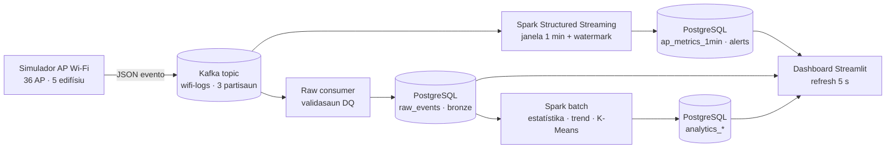

# 📶 University Wi-Fi Usage Monitoring — DIT Big Data Capstone

Sistema Big Data ne'ebé monitoriza uzu Wi-Fi kampus Dili Institute of Technology iha **real-time**:
simulador log Access Point → **Apache Kafka** → **Apache Spark** (streaming + batch) → **PostgreSQL** → **Streamlit**.

## Arkitetura



Estilu arkitetura: **Lambda** — *speed layer* (Spark Streaming → métrika kada minutu) no
*batch layer* (Spark batch → analitika istóriku + ML), rua-rua serve ba dashboard ida.

## Estrutura folder

```
dit-wifi-bigdata/
├── docker-compose.yml          # Kafka (KRaft) + Kafka UI + PostgreSQL
├── requirements.txt
├── sql/schema.sql              # Storage schema (bronze, gold, analytics, DQ)
├── producer/wifi_producer.py   # Kafka PRODUCER — simulador log Wi-Fi
├── consumer/raw_consumer.py    # Kafka CONSUMER — validasaun + arkivu raw
├── spark/streaming_job.py      # Spark Structured Streaming (real-time)
├── spark/batch_analytics.py    # Spark batch (descriptive, trend, stats, K-Means)
├── dashboard/app.py            # Streamlit dashboard real-time
├── tests/test_pipeline.py      # Unit test (pytest)
└── docs/
    ├── ESTRUTURA_PROPOSAL_REPORT.md
    └── TEST_PLAN.md
```

## Rekezitu

Docker Desktop, Python 3.10–3.12, no **Java 17** (Spark 3.5 presiza Java 8/11/17). Laptop RAM ≥ 8 GB.

```bash
python -m venv .venv && source .venv/bin/activate      # Windows: .venv\Scripts\activate
pip install -r requirements.txt
```

## Orden ezekusaun (terminal 5)

| # | Terminal | Komandu | Saida |
|---|----------|---------|-------|
| 1 | T1 | `docker compose up -d` | Kafka :9092, Kafka UI :8080, PostgreSQL :5432 |
| 2 | T1 | `python -m consumer.raw_consumer` | rai kada evento iha `raw_events` |
| 3 | T2 | `python -m producer.wifi_producer --mode backfill --records 20000 --days 7` | 20,000 record istóriku (≥ 10,000 rekezitu) |
| 4 | T3 | `python spark/streaming_job.py` | agregasaun real-time, Spark UI :4040 |
| 5 | T2 | `python -m producer.wifi_producer --mode live --rate 30 --load 0.9` | stream real-time |
| 6 | T4 | `streamlit run dashboard/app.py` | dashboard :8501 |
| 7 | T5 | `python spark/batch_analytics.py` | analitika istóriku + ML (halai fali kada oras) |

Nota: halai **backfill antes** Spark streaming, tanba streaming job uza `startingOffsets=latest`
(dadus istóriku ba batch layer liuhosi consumer; dadus foun ba speed layer).
Atu hahú fali streaming husi zero: `rm -rf checkpoints/`.

## Skript demonstrasaun (±10 minutu)

1. **Fonte dadus (1 min)** — Hatudu terminal producer: "Kada liña mak log husi AP; 30 evento/segundu. Iha kampus loos, dadus ne'e mai husi Wi-Fi controller liuhosi syslog ka REST API."
2. **Kafka (1.5 min)** — Loke Kafka UI (localhost:8080) → topic `wifi-logs` → hatudu mensajen JSON, 3 partisaun, no consumer group `wifi-raw-archiver` ho lag besik 0.
3. **Spark Streaming (2 min)** — Hatudu terminal Spark: tabela console kada edifísiu atualiza kada 10 s. Loke Spark UI → *Structured Streaming* → input rate vs processing rate. Esplika watermark no janela 1 minutu.
4. **Storage (1 min)** — `docker exec -it postgres psql -U wifi -d wifi_monitoring -c "SELECT count(*) FROM raw_events;"` — halai dala rua, númeru sae.
5. **Dashboard real-time (2 min)** — Tab *Real-time*: KPI no gráfiku muda mesak kada 5 s; live feed hatudu evento foun.
6. **Simula insidente (1.5 min)** — Para producer, halai fali ho `--incident-ap LAB-F2-AP03`. Iha minutu ida alerta HIGH_LATENCY / PACKET_LOSS mosu iha dashboard.
7. **Analitika + ML (1 min)** — Tab *Analitika istóriku*: heatmap oras × loron, trend, korrelasaun RSSI–latency, klaster K-Means (hotspot vs beban ki'ik).
8. **Data quality** — Tab *Kualidade dadus*: validity/uniqueness %, razaun dadus invalidu (producer hatama 2% dadus foer ho hakarak).

## Testa

```bash
pytest -v                       # unit test
```
Planu teste kompletu (functional, performance, data quality, scalability): `docs/TEST_PLAN.md`.

## Troubleshooting

- **`NoBrokersAvailable` / timeout** — Kafka seidauk prontu; hein 20 s depois `docker compose up`.
- **Spark download jar falla** — presiza internet dala uluk (Maven) ba `spark-sql-kafka` no `postgresql` jar.
- **Dashboard mamuk** — verifika streaming job no producer live halai; tab Analitika presiza batch job.
- **`JAVA_HOME` error** — instala Java 17 no define `JAVA_HOME`.
- **Uza fonte dadus loos** — troka `WifiSimulator` ho leitor syslog/REST API husi controller (UniFi `/api/s/default/stat/sta`, Aruba, Cisco); mantein formatu JSON hanesan atu pipeline la muda.
